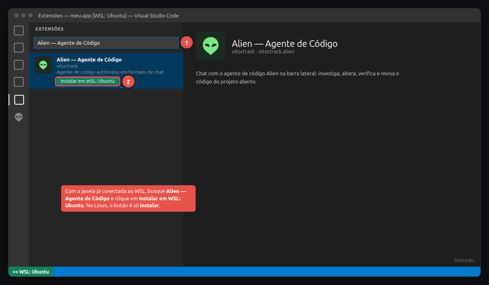
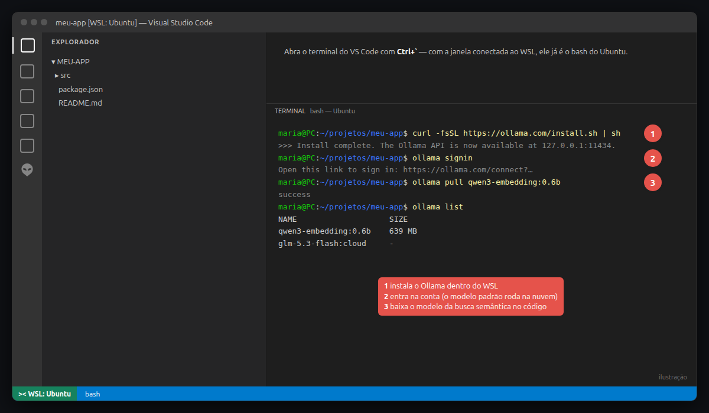
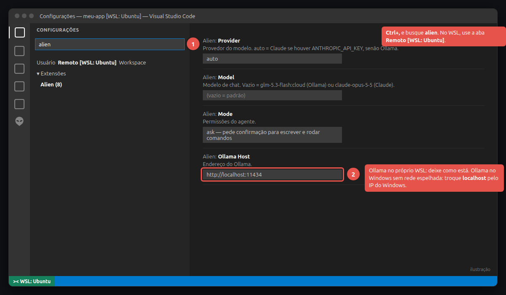
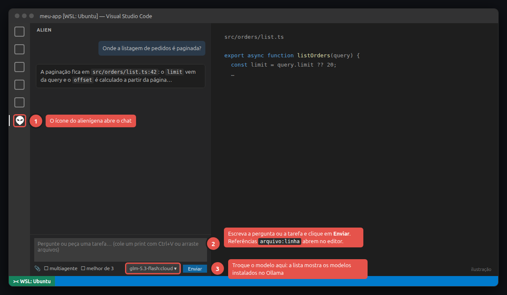

# Alien para VS Code

Chat com o agente de código autônomo Alien na barra lateral (ícone do alienígena).

- Pergunte sobre o código ou peça alterações: ele investiga, altera, verifica e passa por um revisor independente.
- Referências `arquivo:linha` nas respostas abrem o arquivo na linha.
- Pedidos de permissão (escrita, comandos) aparecem como botões **Permitir / Negar** (modo `ask`).
- Troque o modelo no seletor do chat (lista os modelos instalados no Ollama).
- Anexe prints e arquivos com 📎, Ctrl+V ou arrastando.
- Marque **multiagente** para dividir a tarefa em fatias com checagens de pronto e uma revisão final.

Configurações em *Settings → Alien*: provedor (Ollama local ou Claude), modelo, permissões, idioma, revisão e modelo de embedding.

## Como começar

**Sistemas:** Linux x64 e Windows pelo WSL (o Windows sem WSL não é suportado). As imagens são ilustrações de cada passo.

**No Windows, antes:** instale o WSL (`wsl --install` no PowerShell como administrador e reinicie), instale a extensão **WSL** no VS Code e abra o projeto com `F1` → **WSL: Connect to WSL**. Passo a passo com imagens e links oficiais no [README do projeto](https://github.com/vitortrack/alien#guia-passo-a-passo-vs-code).

**1. Instale o Alien.** Em Extensões, busque **Alien — Agente de Código** e clique em **Instalar** (no Windows conectado ao WSL: **Instalar em WSL: Ubuntu**).



**2. Instale o Ollama e os modelos** no terminal do VS Code (``Ctrl+` ``):

```bash
curl -fsSL https://ollama.com/install.sh | sh
ollama signin                       # modelo padrão glm-5.3-flash:cloud, na nuvem do Ollama
ollama pull qwen3-embedding:0.6b    # busca semântica no código (opcional)
```



Prefere o Claude? Exporte `ANTHROPIC_API_KEY` no ambiente em que o VS Code abre.

**3. Confira as configurações** em `Ctrl+,` → **alien** (provedor, modelo, permissões e endereço do Ollama). Os padrões já funcionam com o Ollama local.



**4. Use o chat:** ícone do alienígena na barra lateral → pergunta ou tarefa → **Enviar**. O seletor ao lado troca o modelo.



Requer VS Code 1.90+, `bash`, `git`, `grep` e `find` no PATH (o Ubuntu do WSL já traz).
